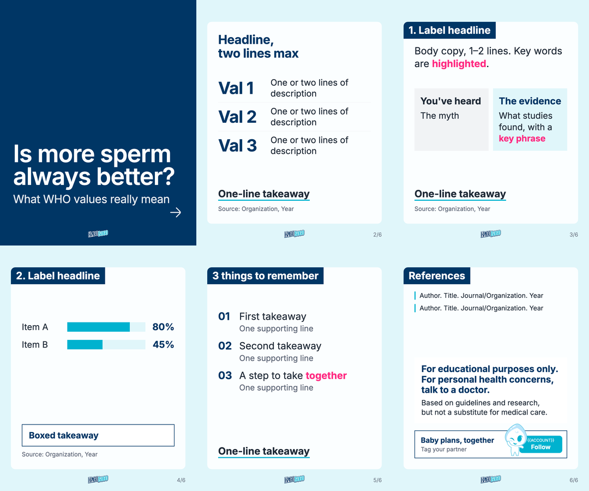

# HAGOBOGO Card News Skill — English edition (hagobogo-cardnews-en)

A skill for Claude Code and Codex that makes informational Instagram carousels ("card news") in English for INTIN Inc.'s **HAGOBOGO**, for English-speaking audiences worldwide.
Give it one keyword and it builds 1080×1350 slides **from verified sources only** (6 by default; a slide is added only when essential content overflows because of the large type), plus long and short captions, a pinned comment, references, and an RA review checklist.

This is the English edition of the Korean skill `hagobogo-cardnews`. The workflow, brand rules, and layout are the same; copy, sources, length limits, font, and image direction are localized for a global English-speaking audience.



---

## What it makes

| Output | Contents |
|---|---|
| Slide PNGs (6 by default) | 1080×1350 (4:5 portrait), `slides/01.png` onward (not zipped) |
| Preview sheet | The slides shrunk and tiled (6 slides: 2 rows of 3; 7–8 slides: 2 rows of 4) |
| `caption.md` | Long caption, short caption (about 130 words), pinned comment (about 90 words) in a `key info + HAGOBOGO suggestion` format, 5 lowercase hashtags (#hagobogo + 4 topic tags, attached to the end of both captions so one copy grabs everything), reference list, RA review checklist, alt text per slide |
| `image_prompts.md` | When there are no background photos: photoreal prompts for each slide, with scenes chosen by analyzing each slide's content (works for Gemini Nano Banana and ChatGPT; starts with a slide content → scene table). Generated images go in `images/` as `bg1.png`–`bg6.png` |

## Topics

Limited to the stage **before** pregnancy.

1. Male factors in infertility
2. Sperm health (lifestyle, environment, nutrition, what test parameters mean)
3. Preconception fact-checks (myths vs evidence)
4. Couple health
5. Relationship care (stress and communication while trying to conceive)
6. Family planning (timing, age, order of preparation)

It doesn't cover pregnancy care, birth and postpartum, parenting, policy and social issues, or celebrity stories. For such keywords it says they're out of scope and suggests the nearest in-scope topic.

## What changed from the Korean edition

| Item | Korean edition | English edition |
|---|---|---|
| Audience | Korean couples | English-speaking couples worldwide (US spelling, "partner/couple" by default, diverse imagery) |
| Font | Pretendard (npm install) | **Inter**, bundled in `assets/fonts/` (no npm or network) |
| Line height | Cover title 1.12, body 1.4–1.55 | Cover title 0.95, body 1.25–1.3 (Latin lowercase is shorter) |
| Cover title | About 7 characters × 2 lines | About 14 characters × 2–3 lines (render.py flags 4+ lines) |
| Body copy | About 80 characters per slide | About 30 words per slide |
| Captions | Short caption about 350 characters, pinned comment about 250 characters | Short caption about 130 words, pinned comment about 90 words |
| Standard disclaimer | Korean sentence ("This is reference content. Consult a specialist about personal health issues.") | For educational purposes only. For personal health concerns, talk to a doctor. |
| Hashtags | Korean brand tag + 4 topic tags | #hagobogo + 4 topic tags, all lowercase |
| Sources | Includes Korean agencies and societies | International guidelines first (WHO, ESHRE, ASRM, AUA, EAU, NICE, ACOG, RCOG, CDC, NHS), national agencies by name |
| Temperatures | Source value as is | Source value first, °C ↔ °F may be added in parentheses |
| Follow button | Fixed account handle | `{{ACCOUNT}}` placeholder, filled in for each post (render.py warns if left in) |
| Logo | Korean (Hangul) wordmark | English HAGOBOGO wordmark (see "Replacing the logo") |

---

## Folder structure

```
hagobogo-cardnews-en/
├── SKILL.md              # The skill (workflow, brand and regulatory rules, template, render.py, preview.py, caption_check.py, watch_codex.sh, logo base64)
├── assets/
│   ├── template.html     # 6-slide HTML template (background photo + white panel layout)
│   ├── logo_en.png       # HAGOBOGO English logo (transparent, 282×118, empty margins trimmed; shown on every slide)
│   ├── fonts/            # Inter font files (woff2, Latin + Latin Extended, weights 300–700) + OFL.txt license
│   ├── character_hc12.png  # HAGOBOGO character (supplied by the brand team, next to the Follow button on slide 6)
│   ├── andrsrxn--arrow-right.svg  # Source of the cover arrow (inlined in the template)
│   └── preview.png       # Template preview (how it looks without background photos)
└── scripts/
    ├── render.py         # HTML → one PNG per slide + overflow, highlight, and placeholder checks
    ├── preview.py        # Preview sheet of the slide PNGs
    ├── caption_check.py  # caption.md format check (word counts, hashtags, standard disclaimer, pinned-comment HAGOBOGO paragraph)
    ├── watch_codex.sh    # Watches image generation in a Codex pane (files saved + task finished)
    └── update_logo.py    # Swaps in a new logo (assets/logo_en.png + base64 block and checksum in SKILL.md)
```

> `SKILL.md` contains the template (including the arrow icon), the render, preview, and caption scripts, and the logo (base64), so the skill works with `SKILL.md` alone.
> `assets/` and `scripts/` hold the same content as separate files. `update_logo.py` is a maintenance tool and is not embedded. The fonts can't be embedded; with `SKILL.md` alone, install them with `npm install @fontsource/inter` (SKILL.md Step 6 explains how).

---

## Install

### Claude Code

Name the skill folder `hagobogo-cardnews-en`. It can be installed alongside the Korean `hagobogo-cardnews` without a name clash.

```bash
# Personal (global) skill
cp -R hagobogo-cardnews-en ~/.claude/skills/hagobogo-cardnews-en

# Or for one project only
cp -R hagobogo-cardnews-en .claude/skills/hagobogo-cardnews-en
```

Or clone it straight from GitHub:

```bash
git clone https://github.com/intin-site/hagobogo_cardnews_skill_en.git ~/.claude/skills/hagobogo-cardnews-en
```

### Codex

Copy the folder into Codex's skills folder. Codex also picks up project skills from `.agents/skills/` in the project folder.

```bash
# Global (all projects)
cp -R hagobogo-cardnews-en ~/.codex/skills/hagobogo-cardnews-en
# or: git clone https://github.com/intin-site/hagobogo_cardnews_skill_en.git ~/.codex/skills/hagobogo-cardnews-en

# Or one project only
mkdir -p .agents/skills && cp -R hagobogo-cardnews-en .agents/skills/hagobogo-cardnews-en
```

Notes for Codex (details in SKILL.md "Running in Codex"):
- Claude tool names in SKILL.md map to Codex tools: `request_user_input` (questions), `web.run` (research), `view_image` (checking PNGs), and Codex's own image generation for backgrounds.
- On macOS, `render.py` (Playwright Chromium) can't run inside the Codex sandbox. Approve it when Codex asks to run it outside the sandbox, or run Codex in full-access mode.
- After updating the skill, copy it to `~/.codex/skills/` again.

### ChatGPT desktop app

**Why use the ChatGPT desktop app:** it has built-in image generation. Codex in the app can make the background photos, object images, and content characters in the same session, save them straight into the work folder, and render the slides, with no prompts to copy into another image service. Claude Code can only write the prompts (`image_prompts.md`) for you to generate elsewhere.

The ChatGPT desktop app includes Codex, and it uses the same skills folder as Codex (`~/.codex/skills/`). So:

1. **Check whether the skill is already there.** If you installed it for Codex (above), it also shows up in the ChatGPT desktop app. Start a Codex task in the app and look for `hagobogo-cardnews-en` among the skills, or ask: "Is the hagobogo-cardnews-en skill available?"
2. **If it isn't, install it from GitHub** in Terminal, then start a new Codex task in the app (restart the app if it still doesn't appear):

   ```bash
   git clone https://github.com/intin-site/hagobogo_cardnews_skill_en.git ~/.codex/skills/hagobogo-cardnews-en
   ```

3. **To update it later**, pull the latest version (this works when you installed it with `git clone`):

   ```bash
   cd ~/.codex/skills/hagobogo-cardnews-en && git pull
   ```

For step-by-step use, see "Usage → 9. Using it in the ChatGPT desktop app". The one-time Python setup in "Usage" is needed on the Mac as well.

### Claude app (claude.ai)

Zip this folder and upload it in the skills settings. Leave out the `.git` folder when zipping.

```bash
# Run from the parent folder of the skill folder
zip -r hagobogo-cardnews-en.zip hagobogo-cardnews-en -x '*/.git/*' '*.DS_Store'
```

---

## Usage

### 1. One-time setup

The skill renders slides with Python, Playwright (headless Chromium), and Pillow. The Inter font is bundled, so you don't need Node.js or npm.

```bash
python3 -m pip install playwright pillow
python3 -m playwright install chromium
```

Check that everything works by rendering the bare template once (replace `<skill folder>` with where you installed the skill):

```bash
mkdir -p /tmp/hagobogo-test && cd /tmp/hagobogo-test
cp <skill folder>/assets/template.html slides.html
cp <skill folder>/assets/logo_en.png <skill folder>/assets/character_hc12.png .
cp -R <skill folder>/assets/fonts fonts
python3 <skill folder>/scripts/render.py slides.html slides
```

You should see `slides/01.png`–`06.png` and only two notices: the `{{ACCOUNT}}` placeholder warning and "Missing background photo". Both are expected for the bare template.

### 2. Start a carousel

Open Claude Code, Codex, or Codex in the ChatGPT desktop app in the folder where you want the work saved (the skill creates `cardnews/<YYYYMMDD>_<topic>/` there) and ask in plain language:

```
Make a HAGOBOGO carousel
Make a HAGOBOGO carousel about "smoking and sperm"
Make a HAGOBOGO carousel about sperm count. Our Instagram handle is hagobogo.global
```

You can talk to the skill in any language; the slides, captions, and documents always come out in English.

### 3. What the skill asks, and how to answer

A full run has four points where the skill stops for your input. Everything else runs on its own.

**① Keyword and Instagram handle**

If you didn't include them, the skill first asks "What keyword should this carousel be about?" and, if it isn't known yet, the Instagram handle for the Follow button on the closing slide. Answer with a word or short phrase (`sperm count`, `timing sex`, `smoking and sperm`, `age and fertility`). If you don't have the handle yet, say so; the slide keeps a `{{ACCOUNT}}` placeholder and `render.py` keeps warning until you fill it in.

**② Keyword check and topic choice**

The skill searches quickly and shows a check table:

| Check | Result (example for "sperm count") |
|---|---|
| Scope | In scope (sperm health) |
| ① Existing followers care? | Yes — core topic for couples trying to conceive |
| ② General TTC audience taps? | Yes — common question |
| ③ First-time viewers curious? | Partly → widened with a myth flip |
| Evidence | WHO laboratory manual, 6th edition (2021) |

The questions come from Paddy Galloway's CCN audience model. Posts with huge view counts happen when people seeing the account for the first time watch, so the topic is checked before any cover copy is written:

| Audience | For HAGOBOGO | Check question |
|---|---|---|
| Core | Couples trying to conceive who follow HAGOBOGO | ① Will existing followers care? |
| Casual | People interested in trying to conceive, sperm health, or couple health | ② Would someone generally interested in trying to conceive tap? |
| New | People who know neither the account nor much about trying to conceive (Explore, Reels, friends' shares) | ③ **Would someone seeing HAGOBOGO for the first time be curious?** |

Then it offers **3 topic candidates** as a multiple-choice question, each with a cover draft, one key source, and the ①②③ results:

| Candidate | Reaches | Example |
|---|---|---|
| Broad (recommended) | Core + Casual + New | "Is more sperm / always better?" |
| Interested | Core + Casual | "5 habits that / lower sperm count" |
| Core | Core only | "How to read / your semen analysis" |

Pick one, or type your own topic or changes ("Broad, but make it about laptops"). If ③ is weak, the skill widens the keyword with a hook (comparison, myth flip, everyday link, quiz) instead of dropping it. Broad is the default recommendation unless its evidence is weak or it conflicts with the regulatory rules.

If you attach a reference image or another account's post, the skill uses it only for ideas. It checks every number in it against the original paper and shows a `Reference claim | What the original says` correction table. Numbers it can't confirm are dropped.

**③ Images**

Once the storyboard is set, the skill asks which images you want before it writes any prompt or generates anything. It shows a recommended plan as the first option:

| Choice | What it means |
|---|---|
| Background photos | New for each slide, your own photos, or several slides sharing one |
| Object images | Products, packaged food, or other objects placed on the cards (transparent background, no text or logos) |
| Content characters | A character that shows the content (e.g., a sperm character). The brand characters Hago and Bogo are never AI-generated |
| Cover style | Photoreal or 3D illustration, and whether the image needs any text (e.g., a store sign) |

How the images get made depends on where you run the skill:
- **Your own photos**: put them next to `slides.html` as `images/bg1.png`, `images/bg2.png`, … (numbered like the slides; JPGs work if renamed).
- **ChatGPT desktop app or Codex CLI**: Codex generates the images itself and saves them in `images/`. This built-in image generation is the main reason to run the skill in the ChatGPT desktop app (see section 9).
- **Claude Code**: the skill writes `image_prompts.md` (one prompt per slide). Paste the prompts into Gemini or ChatGPT, or, if a logged-in Codex pane is open in the Orca terminal, the skill hands them to that pane.
- **No images**: the slides fall back to solid colors (navy cover, light cyan body slides).

**④ Final check before delivery**

After rendering, the skill opens every PNG and reviews it (overflow, line breaks, typos, sources, banned wording). Then it delivers the files with a short note on what you should check, usually places where the source judgment was close and wording that needs RA review.

### 4. What you get

```
cardnews/20261101_office-lunch-picks/
├── slides/01.png … 06.png   # the carousel, ready to upload in order
├── preview_sheet.png        # all slides on one image for a quick review
├── caption.md               # long caption, short caption, pinned comment, references, RA checklist, alt text
├── sources.md               # every card sentence next to the original sentence and citation
├── storyboard.md            # chosen topic, check results, and the slide-by-slide plan
├── image_prompts.md         # only if images were generated or prompts were written
├── slides.html              # the editable source of the slides
├── images/                  # background and object images
├── fonts/, logo_en.png, character_hc12.png   # copied from the skill for rendering
└── render.py, preview.py, caption_check.py   # copies of the scripts
```

`caption.md` sections:

| Section | Use |
|---|---|
| `## Long caption` | Full caption with the evidence, disclaimer line, call to action, and hashtags |
| `## Short caption` | About 130 words, same hashtags; post this one if you want a shorter caption |
| `## Pinned comment` | About 90 words: key info + a HAGOBOGO suggestion (observe wording only). Post it as the first comment and pin it |
| `## References` | Full citations (the cards show at most 4) |
| `## RA review checklist` | Items for the internal RA/QA reviewer to tick |
| `## Alt text` | One line per slide |

### 5. Changing things after delivery

You can ask the skill in the same conversation, for example "Shorten the slide 3 headline", "Swap slides 4 and 5", or "Make the cover white". The skill edits `slides.html` and renders again.

To edit by hand, change `slides.html` in the work folder and run:

```bash
python3 render.py slides.html slides
python3 preview.py slides preview_sheet.png
python3 caption_check.py caption.md      # after editing captions
```

- **Replace a background**: save the new image as `images/bgN.png` (same number as the slide) and render again.
- **Add or remove a slide**: copy or delete a `<section class="slide …">` block, then change every page number to `n/total`. `render.py` points out any that don't match.
- **Change the handle**: edit the `<small>` text inside the Follow button on the closing slide.
- **Text too long**: shorten the copy rather than the type size. The skill's limits: cover title about 14 characters per line × 2–3 lines, subtitle about 28 characters, headline 2 lines, about 30 words per body slide.

### 6. Posting to Instagram

1. Get internal RA/QA sign-off using the checklist in `caption.md`.
2. Upload `slides/01.png`, `02.png`, … in order as one carousel post.
3. Copy the whole `## Long caption` or `## Short caption` section. The hashtags are already at the end, after two blank lines.
4. Add the alt text from `## Alt text` to each image (Instagram: Advanced settings → Accessibility).
5. If any image is AI-generated, turn on Instagram's "AI info" label.
6. After posting, add the `## Pinned comment` text as a comment and pin it.
7. Check that the handle on the closing slide is the account you're posting from.

### 7. More example requests

```
Make a HAGOBOGO carousel. Here's a reference post for ideas: <attach image>
Use my photos in ./photos for the backgrounds
No images this time, solid colors are fine
Make it 7 slides, one per weekday
Regenerate the slide 3 background; the scene doesn't match the copy anymore
Write the captions again with a warmer tone
```

### 8. Running it in Codex (CLI or ChatGPT desktop app)

The workflow is the same in the Codex CLI and in Codex inside the ChatGPT desktop app; only a few tools differ (details in SKILL.md "Running in Codex"):

| Step | Claude Code | Codex |
|---|---|---|
| Multiple-choice questions | AskUserQuestion | `request_user_input` (or numbered options in chat) |
| Source research | WebSearch / WebFetch | `web.run` |
| Checking PNGs | Read | `view_image` |
| Background images | `image_prompts.md` (or an Orca Codex pane) | Codex generates them directly |

On macOS, the Codex sandbox blocks `render.py` because it starts Chromium. When Codex asks to run it outside the sandbox, approve it (or run Codex in full-access mode). Fetching pages with curl also needs network access; `web.run` doesn't.

### 9. Using it in the ChatGPT desktop app

Use the ChatGPT desktop app when you want the images made for you. Its built-in image generation lets one session go from keyword to finished slides with real backgrounds, without a separate image tool.

1. **Make sure the skill is installed** (see "Install → ChatGPT desktop app"). If it doesn't show up, install it from GitHub.
2. **Start a Codex task in the app** and choose the local folder where the work should be saved. The skill creates `cardnews/<YYYYMMDD>_<topic>/` inside it.
3. **Ask for a carousel**, the same way as anywhere else:

   ```
   Make a HAGOBOGO carousel about "laptop heat and sperm". Our Instagram handle is hagobogo.global
   ```

4. **Answer the questions** (keyword check, topic choice) in the app. The choices appear as multiple-choice options.
5. **At the image question, choose to generate the images.** Say which slides need new backgrounds, whether any slides should share one, and whether you want object images (e.g., packaged food) or a content character. Codex then:
   - writes `image_prompts.md` with a slide content → scene table and one prompt per image,
   - generates each image with the app's image generation,
   - saves backgrounds as `images/bg1.png`, `images/bg2.png`, … at 1080×1350 and object images at 1024×1024,
   - checks every image for text, logos, recognizable faces, and other excluded elements, and redoes any that fail.
6. **Approve `render.py`** when Codex asks to run it outside the sandbox (macOS blocks the Chromium it uses inside the sandbox). Codex renders the slides, looks at each PNG, and fixes any overflow.
7. **Review the deliverables** in the work folder (`slides/`, `preview_sheet.png`, `caption.md`, …) and post them as described in section 6.

Tips:
- **Redo one image** by asking, e.g., "Regenerate the slide 3 background; show a desk with the laptop on it." Codex updates that slide's prompt in `image_prompts.md` first, then regenerates and re-renders.
- **Mix and match**: you can supply some photos yourself (`images/bgN.png`) and let Codex generate the rest.
- **Text inside an image** (such as a store sign) is generated only when you ask for it. Zoom in to check that it's spelled correctly.
- **AI label**: generated images are AI-made, so turn on Instagram's "AI info" label when posting.
- **Usage limits**: image generation counts toward your ChatGPT/Codex usage. A typical carousel needs 5–8 images, plus retries.

### 10. Troubleshooting

| Message | What to do |
|---|---|
| `slide N: <…> overflows` / `content runs into the white panel's bottom padding` | Shorten the copy on that slide. If the content is essential, add a slide |
| `cover: <h1> has too many lines` | Shorten the cover title (about 14 characters per line, 3 lines at most) |
| `page number … -> change to n/total` | Fix the page numbers after adding or removing slides |
| `highlight "…" is not pink` / `became a block` | Wrap highlights only in `<span class="hl">`; check whether another rule overrides it |
| `placeholder {{ACCOUNT}} is still in the slide` | Put the Instagram handle on the Follow button |
| `font failed to load` | Copy the skill's `assets/fonts/` next to `slides.html` as `fonts/` |
| `Missing background photo (solid color used instead)` | Just a notice. Add `images/bgN.png` if you want a photo on that slide |
| `ModuleNotFoundError: playwright` or `PIL` | `python3 -m pip install playwright pillow` |
| `Executable doesn't exist … chromium` | `python3 -m playwright install chromium` |
| `bootstrap_check_in … Permission denied` (Codex) | Run `render.py` outside the Codex sandbox (approve the prompt) |
| `preview_sheet.png (0 slides …)` | `render.py` didn't run or failed; fix that first |
| caption_check: `hashtags must be all lowercase` / `5 hashtags` / `2 blank lines` | The hashtag line must be exactly 5 lowercase tags starting with `#hagobogo`, with two blank lines above it |
| caption_check: `standard disclaimer line is missing or altered` | Use the line `Note: For educational purposes only. For personal health concerns, talk to a doctor.` exactly |
| caption_check: `banned wording in the HAGOBOGO paragraph` | Describe HAGOBOGO only with "observe" wording (no test, diagnose, measure, analyze, count, …) |
| caption_check: word count outside the range | Short caption 95–170 words, pinned comment 60–120 words |

---

## Workflow

| Step | What happens | Output |
|---|---|---|
| 1. Ask for a keyword | Get the keyword → check it (scope, audience ①②③, evidence) → choose from 3 recommended topics (if reference images are given, a correction table checking their numbers against originals comes too) | One-line check result at the top of storyboard.md |
| 2. Source research | Record only evidence confirmed by opening the original | `cardnews/<YYYYMMDD>_<topic>/sources.md` |
| 3. Storyboard | 6 slides by default (cover → intro → 2 body slides → summary → closing). Slides are added for essential overflow | `cardnews/<YYYYMMDD>_<topic>/storyboard.md` |
| 4. Copywriting | Cover hook, body, closing copy | — |
| 5. Regulatory and wording check | Medical-device or diagnosis implications, pregnancy guarantees, and other banned wording | — |
| 6. Design and production | Fill the template, add background photos, render (without photos, write per-slide prompts) | `slides.html`, `slides/*.png`, `image_prompts.md` |
| 7. Review | Overflow, typos, source accuracy, regulatory items | — |
| 8. Delivery | `slides/` PNGs, preview sheet, `caption.md` (+ `image_prompts.md`) | Final deliverables |

### Source standards

- Every number comes **only from originals opened during this task**. No rounding or conversion (temperatures may add °C ↔ °F in parentheses).
- Tier 1: clinical guidelines and official bodies such as WHO, AUA/ASRM, EAU, ESHRE, NICE, ACOG, RCOG, CDC, NHS, and national health agencies
- Tier 2: peer-reviewed systematic reviews and meta-analyses such as Cochrane
- Tier 3 (supporting): original large cohort studies and RCTs
- Blogs, forums, news articles on their own, vendor sites, Wikipedia, AI summaries, and other Instagram or TikTok accounts are never used.

---

## Rendering by hand

Use this when you edit the template by hand and want PNGs.

### Requirements

- Python 3 + Playwright (Chromium)

```bash
pip install playwright
python3 -m playwright install chromium
```

### Run

```bash
# Work folder name = creation date + topic (e.g., cardnews/20261031_autumn-trip-plan)
mkdir -p cardnews/20261031_my-topic && cd cardnews/20261031_my-topic
cp -R ../../assets/fonts fonts           # bundled Inter font; fonts/ must sit next to slides.html

cp ../../assets/template.html slides.html
cp ../../assets/logo_en.png .
cp ../../assets/character_hc12.png .     # slide 6 character
# Edit slides.html (replace {{ACCOUNT}} with the Instagram handle)
# If you have background photos, create an images folder and name them bg1.png – bg6.png (matching the slide numbers)
mkdir -p images

python3 ../../scripts/render.py slides.html slides
python3 ../../scripts/preview.py slides preview_sheet.png   # preview sheet (requires Pillow)
python3 ../../scripts/caption_check.py caption.md           # caption format check
```

`render.py` saves `slides/01.png` onward and reports these problems:

- Elements that overflow the slide
- Content that runs into the bottom padding of the white panel (`.panel`)
- Cover title over 3 lines, subtitle over 1 line
- Fewer than 6 slides (with more than 6, it asks you to confirm the extra slide is essential)
- Page numbers that don't match `n/total`
- Highlights (`.hl`) that another rule turned non-pink (`#FF2A81`), or that became blocks and break the line
- Leftover placeholders such as `{{ACCOUNT}}`
- Fonts that failed to load (the `fonts/` folder is missing next to `slides.html`)

With no problems it prints `No overflow`. Slides whose background photo file is missing are reported separately as `Missing background photo (solid color used instead)`. It can't catch elements overlapping each other, so open the PNGs and check.

### Making background and object images with Codex (optional)

Before making any images, Claude asks which ones are needed: background photos (new, your own, or shared across slides), object images to place on cards (products, packaged food, etc.), content characters, and cover style (photoreal or 3D, any signage text).

If a logged-in Codex pane (with the `image_generation` feature on) is open in the Orca terminal, `image_prompts.md` can be handed to that pane to generate and composite the images right away.

```bash
orca terminal list                                    # find the Codex pane handle
orca terminal send --terminal <handle> --text "$(cat request.txt)" --enter --wait-submit 20 --json
orca terminal read --terminal <handle> --screen        # check progress
scripts/watch_codex.sh <handle> images bg1 bg2 food_mon   # watch in the background (files saved after start + task finished)
```

- Completion means `images/bgN.png` saved + Codex finished (`esc to interrupt` gone from the screen). A done marker written into the request is never used as the signal, because the request itself reappears on the pane screen.
- To redo one slide, back up the existing background and fix that slide's prompt in `image_prompts.md` first.
- If the request changes mid-generation, fix `image_prompts.md` and send the change to the same pane (the result shows `input_accepted`).
- Object images are 1024×1024 with transparent backgrounds and packaging with no text, logos, or barcodes. For characters, make a base image first, use it as the reference for pose variations with the same look, and check them on a comparison sheet.
- Reference images with stock watermarks are never passed as generation input; only their style is described in words.
- After generating, zoom in on any text inside images (signage, etc.). If the cover subject covers the title, regenerate, or shift the image up and fill the bottom strip by flipping (SKILL.md Step 6).
- Without a Codex pane, paste `image_prompts.md` into Gemini or ChatGPT directly. Turn on Instagram's "AI info" label for AI images.

### Layout

- **Slide 1 cover**: background photo (`images/bg1.png`) full bleed + dark shade at the bottom + white title (2–3 lines), white arrow at the bottom right. Solid navy without a photo.
- **Slides 2–6 body**: on the background photo (`images/bg2.png`–`images/bg6.png`), a white panel centered on the page (solid white at 85%, 24px rounded corners, 120px inset top and bottom, 60px left and right) holds the content. The photo frames the panel. Solid light cyan without a photo.
- Font: Inter. Weights 300–700 only (heaviest 700).
- Line heights are tighter than the Korean edition (Latin lowercase is shorter, so the same value looks looser): cover title 0.95, subtitle 1.15, headline 1.1, lead 1.3, list and body 1.25, takeaway 1.3.
- Body type (readable instantly on a phone): label 56px, headline 68px, lead 54px, list 54px (supporting 44px), row text 48px, box 48px, takeaway 55px, source 33px, references 36px, disclaimer 40px. If it overflows, tighten the copy; add a slide if the content is essential. The central block (`.mid`) shares the leftover space above and below.
- The topic title box (label) sits flush in the panel's top-left corner.
- The logo is the same size and position on every slide (bottom center, 48px tall); on slides 2–6 it sits in the strip outside the panel. The page number sits on the right of the same strip in white with no background (weight 300, with a strong shadow so it reads on bright photos).

### Slide types (template classes)

| Type | Class | Use |
|---|---|---|
| Cover | `.cover.photo` (photo, default) / `.cover` (solid navy) / `.cover.white` (white) | Slide 1 |
| Body frame | `.slide.bg` + `.panel` (central white panel) + `.page` (page number) and `.brand` (logo) outside the panel | Slides 2–6 |
| Number rows | `.rows` (big number + description, units in `<small>`, `<b>` in the description is the item-name line) | Intro, 3 key figures / per-item numbers for list-type topics |
| Two big numbers | `.nums` (borderless white boxes, units in `<small>`) / `.nums.one` (one cell) | Compare two amounts or rates / one key figure |
| Bar chart | `.bars` + `--v` (0–100) | Comparing percentages |
| Comparison table | `.vs` (`.myth` / `.fact`) | You've heard vs The evidence |
| O/X and numbered list | `.list` (`li.x` = X, supporting line in `<small>`) / `.list.places` (item names 1.5× larger) | Myth roundup, summary slide / places |
| Centered block | `.mid` (add to the visual block) | Slides 2–5 |
| Closing | `.refs` (references) + `.disc` (disclaimer) + `.follow` (two-line Follow button + character) | Slide 6 (if it overflows, slide 6 references / slide 7 disclaimer and follow) |
| One-line takeaway | `.bottom` (underline) / `.box` (border; `<small>` inside is a one-line source) | Slides 2–5 |
| Highlight | `.hl` (pink) | 1–2 per slide |

---

## Replacing the logo

`assets/logo_en.png` and the base64 block in `SKILL.md` hold the English HAGOBOGO wordmark (empty margins trimmed). To replace it with a new transparent PNG (trim empty margins first), run this in the skill folder:

```bash
python3 scripts/update_logo.py /path/to/new_logo.png
```

It replaces `assets/logo_en.png`, the base64 block in `SKILL.md`, and the checksum line together. The slides show the logo at 48px tall with the width following the file, so re-render a test deck afterwards and check the logo strip on every slide.

---

## Brand standards summary

| Color | Code | Use for |
|---|---|---|
| Navy | `#003665` | Headlines, big numbers, labels, takeaway box borders, solid cover background |
| Cyan | `#00B2CF` | Bar charts, underlines, reference list rules, Follow button background (white text) (never small text on white) |
| Pink | `#FF2A81` | Highlighted phrases in tables and body text only |
| Dark gray | `#1F2A37` | Body text |

- Core message: **"I'll go first"** (the English form of the brand's Korean core message) — infertility isn't treated as a woman's problem alone.
- The default viewpoint is **"together"**. Fear-mongering, guilt-tripping, blaming men, and blaming women are all banned.
- Backgrounds are only photo, white, or a solid color. No gradient or blurred backgrounds (the dark shade at the bottom of a photo cover is the only exception).
- When using AI-generated background photos, turn on Instagram's "AI info" label when uploading. Never present AI images as real photos of real places.

---

## Notes

- **Internal RA/QA review is required before posting.** The skill's deliverables say so too.
- The slide body carries no product mentions by default, but the pinned comment includes a HAGOBOGO suggestion. HAGOBOGO (sperm microscope) is described only with "observe" wording, never "test, diagnose, measure, analyze" or similar. No "This doesn't replace a clinic test" sentence (brand decision).
- HAGOBOGO PRO claims stay within the intended use authorized in the market where the post will be seen; regulatory status differs by country.
- The closing-slide disclaimer and both captions carry the standard disclaimer "For educational purposes only. For personal health concerns, talk to a doctor." unchanged (in captions with "Note: " in front).
- The characters Hago and Bogo are used only when the brand team supplies image files. They're never drawn or AI-generated. The supplied `assets/character_hc12.png` goes next to the Follow button on slide 6.
- Rights to the logo and brand assets belong to INTIN Inc.
